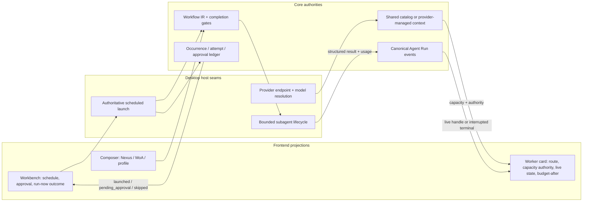

# Orchestration Runtime

[Documentation](../README.md) / [Category overview](README.md)

This document records the current runtime contracts behind Nexa's
Mixture-of-Agents (MoA), Nexus, and orchestration quality profiles. Nexa owns the
implementation and verification of these contracts; the design references below
do not imply wire or configuration compatibility with another project.

## Design sources

- [Together Mixture-of-Agents paper](https://arxiv.org/abs/2406.04692) and
  [reference implementation](https://github.com/togethercomputer/moa) establish
  the parallel reference-model and acting-aggregator pattern.
- [Hermes Agent `moa_loop.py`](https://github.com/NousResearch/hermes-agent/blob/main/agent/moa_loop.py)
  demonstrates production constraints that the original paper does not cover:
  advisors are tool-free, fan-out is bounded, partial advisor failure is not
  fatal, private reference context is filtered, and usage is attributed to the
  model that incurred it.
- [Anthropic's orchestrator-workers and evaluator-optimizer patterns](https://www.anthropic.com/engineering/building-effective-agents)
  motivate independent parallel reconnaissance followed by explicit synthesis
  and verification.
- [Magentic-One](https://github.com/microsoft/autogen/tree/main/python/packages/autogen-magentic-one)
  provides a useful reference for an orchestrator-led multi-agent team with
  specialized workers.
- [LangGraph checkpointing](https://github.com/langchain-ai/langgraph/tree/main/libs/checkpoint)
  informed the decision to make workflow progress serializable rather than
  keeping scheduler state only in a prompt.
- [Anthropic's Managed Agents architecture](https://www.anthropic.com/engineering/managed-agents)
  separates durable session history from the active context window. Nexa applies
  this distinction to exact tool-result readback over its existing turn trace.
- [Anthropic's long-running agent harnesses](https://www.anthropic.com/engineering/effective-harnesses-for-long-running-agents)
  motivate incremental, verified progress. Nexa's completion repair uses new
  file states and satisfied obligations instead of a cumulative repair cap.
- [Codex subagents](https://learn.chatgpt.com/docs/agent-configuration/subagents)
  establish independent inspectable worker threads, parent inheritance for
  omitted model settings, and explicit orchestration controls.
- [Gemini CLI subagents](https://github.com/google-gemini/gemini-cli/blob/main/docs/core/subagents.md)
  demonstrate isolated tool registries, provider/model inheritance, and
  recursion protection.
- [pi's subagent extension](https://github.com/earendil-works/pi/blob/main/packages/coding-agent/examples/extensions/subagent/index.ts)
  demonstrates isolated processes, single/parallel/chain delegation, bounded
  concurrency, streaming usage, and abort propagation.

## Product contracts

Normal delegation does not expose model-authored `max_iterations` or
`timeout_secs` stop controls. Workers inherit the user's configured execution
policy, which is unlimited by default; concurrency, cancellation, context limits
and no-progress protection remain independent. Provider setup keeps optional
execution limits under Advanced, with a reset to automatic settings.

Shared browser and native desktop verification belongs to the parent when a
worker lacks those capabilities. Inferred interaction gates are retained as
parent-owned advisory checks, never marked passed. The worker's preflight records
the pending parent checks. Actual action targets and opaque effects still enforce
reconciliation, including after resume. Subagent cards and the workspace header
show the effective provider/model pair; later runtime receipts replace the
prepared identity without combining fields from different routes.

Windows capture uses one bounded worker pool for startup, frame production and
teardown. A WGC initialization or frame failure can fall back to `PrintWindow`
for the same verified HWND. The fallback respects capture exclusion, rejects
blank frames and crops invisible borders into the same physical coordinate
system. It never captures the desktop or substitutes a foreground/owner window.
Startup and fallback waits are bounded while unfinished native jobs retain their
admission slot. Observation errors retain the exact target and recovery guidance;
they do not claim input delivery or successful verification.

A window `observe` without an observation token first returns an exact-window
selection receipt with `observationPending`; it does not capture or transmit
pixels. Repeating `observe` with that receipt follows the normal screenshot
approval path. A consumed control token may select that same window for a fresh
observation, but cannot authorize another input action.

Physical input revisions are tracked by exact HWND. Pointer motion and activity
in unrelated windows do not invalidate background UIA actions. Global physical
input checks cover the foreground commit stage, after read-only preparation;
`focus_window` still changes global focus and retains conflicting-input guards.
Monitor failure is reported separately from user takeover. Explicit Stop/Escape,
same-target conflicts and post-action reconciliation remain enforced. Resume
uses a fresh observation rather than extending a stale input token.

Native desktop completion follows the actual controlled target. Outstanding
window identities and consumed observation tokens are checkpointed as opaque
metadata; screen text and values are not retained for this purpose. A capture of
another window or a recycled window handle cannot verify an earlier action.
An action's verified same-target post-action capture is already fresh evidence
and can supply the next observation token. Missing or uncertain capture requires
another observation of that exact target. The controller must consume the same
privacy-preserving receipt that is persisted, rather than relying on transient
screen artifacts discarded before the next model step.

Continuation restores pending desktop targets from the current run's durable
plan and a validated checkpoint launch, never from JSON in a user prompt; malformed
or cross-turn checkpoint state fails closed. Both internal and upstream-owned
tool sessions persist these obligations and reject a final answer until the exact
targets are reconciled. An explicitly requested window-close task may instead use
the native host's same-target disappearance receipt after delivered input; ordinary
editing, a failed capture, or text merely mentioning a close shortcut cannot use
that terminal exception. If a native worker finishes after Stop saved the
checkpoint, resume reconciles its persisted Completed receipt only when its
conversation, turn, activity, target identity, and consumed observation match
the original pending control and its saved close contract.
For a host-verified modal dialog dismissal, the obligation instead transfers to
its exact pre-observed owner without granting terminal-close permission. A new
owner capture must begin after the host's handoff timestamp; another window or
an older owner screenshot cannot discharge that obligation, including on resume.

Local verification debt is distinct from an opaque provider-hosted action. A
worker hands exact desktop windows or browser session/tab targets into the
existing workflow checkpoint; fresh matching observations can satisfy them
without replaying input. Old observation tokens, older captures and unrelated
tabs cannot clear these obligations. Imported receipt IDs prevent resolved debt
from reappearing. Legacy local debt can be classified only against a complete
matching canonical callback ledger, including its deterministic audit projection;
missing, reordered, provider-owned or explicitly uncertain effects remain opaque.
A worker without the required observation tool returns an unfinished handoff
rather than retrying an impossible verification loop.

The shared `computer_use` interface resolves an explicit `target.kind` to the
existing browser or window adapter. It preserves DOM references, UI Automation
elements, coordinate systems, fresh observation tokens and specialized actions.
Routing does not change the public callback identity, create a second ToolRun or
replay an uncertain action through another adapter. Scoped adapter availability,
approval and source ownership remain authoritative after routing; audit output
redacts input using the resolved operation while keeping the public target shape.

MoA and Nexus are independent axes. MoA changes how an acting model receives
advice. Nexus changes how the client plans, delegates, checkpoints, and verifies
work. Either may be enabled alone or both may be composed.

Provider reasoning effort remains a third, independent axis. `Code Ultra` and
`Research Ultra` are Nexa orchestration profiles; they must never be sent to a
provider as invented reasoning-effort values.

High-cost behavior is explicit and per conversation. The composer shows when
MoA or a non-balanced profile is active, explains the added calls and token
cost, and preserves an off/balanced path.

## Authority and projection map

Frontend state is never a second authority: controls project saved/runtime
contracts, worker cards project lifecycle artifacts and canonical parent state,
and Workbench projects occurrence decisions returned by the backend seam.

## MoA execution boundary

`MoaProvider` wraps the acting provider without changing the provider contract.
On an eligible cadence it:

1. Builds a deterministic, privacy-filtered advisor view of the turn.
2. Calls configured advisor providers concurrently with no tools.
3. Keeps successful advice when another advisor fails.
4. Appends private labelled advice to the acting aggregator's context.
5. Lets only the aggregator use tools, stream user-visible output, and own turn
   termination.
6. Aggregates normalized usage while retaining per-slot model and reasoning
   settings.

The built-in presets (`Fast Review`, `Deep Research`, and `Cross-model Code
Review`) are shortcuts over this contract. `Custom` remains bounded by the same
fan-out, cadence, privacy, and token-reserve controls.

Concurrency limits queue all selected advisors rather than dropping later slots.
Each advisor uses its own provider request dialect and reasoning settings. The
default per-advisor reference timeout is 90 seconds; a custom preset can leave
that deadline to its provider. Partial failures preserve successful advice, and
unchanged privacy-filtered context reuses advice within the same turn. Usage is
returned per invocation, so concurrent turns cannot charge each other's calls.
External CLI/ACP profiles are not converted into HTTP advisor endpoints.

## Workflow IR and Nexus execution

Nexus compiles the typed task plan into versioned `WorkflowIr` before the first
model request. The IR is a validated DAG containing dependencies, parallel
groups, model-routing classes, tool policy, write isolation, retry policy,
structured deliverables, an evidence ledger, checkpoints, verification gates,
and a completion contract.

The ordinary `Balanced` profile may still publish a task-plan artifact for
observability, but that artifact is advisory: it is omitted from the model
prompt, unfinished plan nodes do not reject a valid answer, and `update_plan`
is never a prerequisite for evidence, file, shell, or verification tools.
Strong node-completion gates are activated only by explicit Nexus,
Deep/Custom/Ultra, or scheduled-isolation policy. In those modes the
controller's tool results, checkpoints, and verification records are
authoritative; model-authored plan prose is only a projection.

Balanced code and evidence-required tasks also compile an IR. For code tasks,
the controller detects test/lint/typecheck/build tooling in the selected project
workspace before consulting indexed sources. Ordinary read-only inspection does
not require those commands: the host's first source inventory establishes a
baseline, and a subsequent change or unsettled effect activates the applicable
checks. Later changes invalidate earlier receipts. Missing tooling is explicitly
not applicable. Strict and scheduled-isolation policies retain their stronger
gates; Plan Mode still produces a non-executing handoff.
For ordinary knowledge questions, one selected source scope requires one real
evidence receipt instead of a fixed two-source floor. Wider selected scopes and
explicit strict profiles keep their higher evidence requirements.

For non-trivial Nexus turns, the runtime automatically dispatches the first two
ready reconnaissance nodes through `spawn_subagent_batch`. This is a controller
action, not prompt advice. The wave is read-only, each worker has a stable node
id, and worker results update sibling nodes independently. The controller keeps
dispatching any retryable failed node until it succeeds or exhausts its node
retry policy, without discarding successful branches.

These synthetic read-only nodes are explicitly advisory. Exhaustion or an
interrupted attempt remains a failed diagnostic and permits the parent to take
over investigation; it never satisfies required task steps or independent review.
Host-owned continuation state restores the workflow identity, successful siblings,
attempts and original tool/delegation budgets. Late owned receipts are reconciled
without replaying previously started work. Resume is not budget replenishment.

Verification gates bind settled file content and executable/read-only modes. Subsequent
edits invalidate tests, lint, typecheck, build and review receipts, including edits
outside Nexa's file tools. Unchanged reads and checks preserve the receipts. A
Git commit or index change also requires fresh verification to bind review to the
new revision. Older interrupted checkpoints without enough host-owned round
receipts surface an accounting limitation instead of granting a fresh allowance. A
judgement must contain a valid structured verdict, candidate IDs and confidence;
only accepted results with current host-owned candidate provenance can satisfy
independent review. Generic ranking cannot bypass controller-owned patch review.

Source scans run on blocking workers and follow task cancellation. Routine
observations rebuild the file inventory and reuse unchanged per-file hashes for
the active turn. Check, review, browser-evidence, resume and completion boundaries
always read fresh content; metadata cache hits cannot authorize acceptance.
Every scan revalidates its Git or folder inventory and file metadata after
hashing, including nested gitlinks. A clean file becoming dirty or a path
appearing during the scan leaves the source pending, so concurrent formatter
or build changes cannot preserve old verification receipts.
An edit and observation in the same unstable batch cannot produce a green source
receipt, while browser action effects and terminal closure still reconcile.
Native filename and symlink-target bytes remain part of the source identity;
valid non-UTF-8 Unix paths do not block capture or collide through lossy decoding.
Direct tool dispatch persists its round admission before emitting a tool event or
executing. Failures remain accounted across interruption, and resume does not
automatically repeat the first direct dispatch.
Automatic knowledge prefetch is also limited to first entry. A resumed task
keeps its replayable retrieved evidence and remaining tool rounds; further
searches are explicit model actions rather than searches for continuation text.
Live and recovered reconnaissance receipts must match a current authoritative
capture of their shared read scope. Missing, changed or unsettled source receipts
become failed advisories for parent takeover; their claims and evidence are not
adopted or automatically replayed. Isolated write verification retains its own
source scope.

`spawn_subagent` and each batch worker accept an optional plain-text `name`.
Names may contain Unicode and may repeat. Stable agent/session IDs still own
controls, accounting and history; a resumed session inherits its saved display
name unless the caller supplies a new one.

Delegated roles describe the work and never silently select an auxiliary model.
An omitted route inherits the parent's account, provider and model, including
Copilot and Codex subscription runtimes. Only an explicit model or account
selection changes that identity. Running and historical worker cards expose the
effective provider and model from the runtime's preflight receipt.

The worker's typed task owns intent classification and completion gates. Parent
context, allowed tool names and evidence handoffs remain context; they cannot
create browser or desktop obligations for a read-only child. Reconnaissance
does not introduce an automatic 180-second deadline.

The acting agent receives the updated IR and owns mutation and synthesis.
`Code Ultra` additionally requires isolated writes plus test, typecheck, build,
and independent-review gates. `Research Ultra` raises evidence and independent
verification requirements without forcing a code workspace.

## Model-independent stuck-loop recovery

Nexa treats tool calls as structured runtime events, never as promises written
in an assistant draft. Ordinary turns do not require a tool call or a plan:
models may answer directly, use concrete tools, or ask one focused question.
The runtime intervenes only after observed repetition. Consecutive plan/goal
bookkeeping without a concrete action receives one nudge that explicitly makes
bookkeeping optional; continuing the same loop terminates with a structured
error. Repeated call signatures, repeated answer shapes, and consecutive tool
errors have their own bounded counters, and any concrete action resets the
bookkeeping window. This avoids both prompt-specific patches and a global
"must call a tool" policy that would reject valid direct answers.

Project-hook and workflow completion repairs have no cumulative attempt ceiling.
Their profile retry allowance measures consecutive stalled repairs. A new
persisted file-content state, newly passed completion check, completed workflow
node, or verified evidence source renews the allowance. Repeated file states,
no-op writes, hook-only log changes, timestamps, and rewritten explanations do
not. File progress comes from the mutation ledger's owning operation and exact
before/after content hashes; native process lifecycle events and legacy events
without content provenance cannot renew it. Configured tool, token, cost, and
time budgets remain authoritative. A stalled workflow reports failed completion checks instead of misreporting an
exhausted tool-round budget.

Stream recovery uses the same event authority. Answer text, thinking chunks,
and generic tool arguments are resettable drafts until the model sample closes
and the controller dispatches a tool; an interrupted draft is cleared and may
be replayed within the bounded transport budget. A provider-hosted action is a
real replay barrier because it may already have executed remotely, so only that
state suppresses automatic replay. The former `visible_output` shortcut was
removed because it conflated UI projection with side effects and caused
DeepSeek-style streamed write calls to fail before dispatch.

`StreamReset(discardSample=true)` is authoritative across core, durable Run
Events, and the frontend projection. It removes the abandoned answer/thinking
suffix and any preparing tool cards instead of retaining them as a false
cancelled round; completed tools from earlier samples remain. Historical reset
events without this field preserve their legacy projection. Terminal error
classification is independent of the replay barrier: rate limits retain their
retry delay/category, context overflow requests compaction, permanent provider
errors fail, and only typed transient/transport failures use reconnect.

## Selectable context management

**Settings → Appearance → Context management** selects `summary` (default)
or `history` for new Nexa API turns and manual context maintenance. The setting
is outside Advanced. Subscription runtimes continue to own their in-turn
context; this setting does not enable private Codex backend features.

| Mode | Window transition | Cost and tradeoff |
| --- | --- | --- |
| Summary | Generate a recap of older complete exchanges with the existing bounded fallback | A summary call condenses earlier facts |
| Fresh history handoff | Archive and verify the old trajectory, retain task/corrections/system policy, clear assistant/tool reasoning and prior summaries | No summary call; exact facts and notes are read on demand |

Microsoft's [Fork-and-Flush paper](https://arxiv.org/html/2610.07447v1) combines
fresh reasoning trajectories with isolated parallel candidates and external
selection. Nexa adopts only the fresh-history handoff boundary in its existing
history mode. It does not launch candidate forks, score competing workspaces,
or introduce a second context controller.

The active request and subsequent user corrections remain live, together with
stable system policy. All completed assistant/tool exchanges, opaque replay
state and earlier recap text are removed from the next prompt. Existing files,
workspace changes, durable task state and the canonical transcript remain
intact. An unresolved tool-call batch prevents the transition. Afterward, the
model is instructed to inspect existing work and reassess its next step from
current evidence, retrieving only missing facts.

Before changing the live list, Nexa verifies the conversation-scoped archive
inside the transaction. Automatic and manual transitions publish the same
durable context projection, so reopening a conversation does not reinsert the
flushed trajectory. New messages after the checkpoint remain visible. An
unchanged manual checkpoint is a no-op. Storage failure or a superseding edit
cannot authorize dropping live history. Runtime handoff must reduce estimated
input; an oversized retained request still produces an explicit context error.

Step-lived controller prompts and tool-generated visual/document messages are
archived as evidence rather than retained as human corrections. Delegated workers
read the same validated active projection on each admission; an independent
model-keyed cache cannot reintroduce pre-fork history. Bounded handoff loading
excludes archived tool payloads and provider replay state before materializing
worker context, while streaming source-digest validation still checks the old
prefix. Unknown provider capacity stays unknown: the existing external-history
envelope bounds inherited input independently of an unlimited execution budget.

Checkpoint invalidation is scoped to the checkpoint's source messages. Appending
new turns or updating an image-analysis cache without changing model-visible
content does not resurrect archived history. Editing source text or original
attachments invalidates the projection. Commit checks compare the active
generation and original image digest inside the transaction, so invalidation
followed by restoration cannot authorize an older maintenance plan.

Admission and the context meter use the same prepared request and provider replay
projection as the actual model call. A measured prefix is reusable only while its
route, tools and message fingerprint still match; new tail content is estimated.
The canonical transcript remains available for archives and fallback routes, but
its omitted replay content does not inflate the active route's budget. Real
oversized active exchanges still fail explicitly. The UI uses durable snapshots
and current run usage after maintenance; a previous operation's completion event
cannot permanently replace newer measurements when the conversation reopens.

`context_history` lists windows, searches literal text, reads exact items and
retrieves archived notes through `read_notes`. `update_scratchpad` stores concise
factual progress, but those notes are not automatically reinjected in history
mode. Historical text and notes are evidence, not new instructions. Images
remain in the original conversation; the archive does not serialize native
reasoning signatures or provider continuation envelopes.

The design also follows the durable-history/active-context separation in
[pi compaction](https://github.com/badlogic/pi-mono/blob/1402973a9dbe8c627341e04c9744c54953e285ca/packages/coding-agent/src/core/compaction/compaction.ts)
and the bounded recovery practices reviewed in Codex, Hermes and DeepSeek
Harness. Storage and wire tests verify the implemented boundaries; comparative
long-task quality is not established by those tests.

See the [shared handoff plan and archive](../../crates/core/src/context_history.rs),
[live transition](../../crates/core/src/agent/context_handoff.rs), and
[durable maintenance service](../../crates/core/src/context_maintenance/mod.rs).

Tool-result compaction is a projection over the durable turn trace. When a tool
result is shortened, Nexa attaches a `context_history` `read_tool_result` call
only after the exact original has been persisted. The call identifies the
conversation-owned turn, tool call, and stable runtime result ID; Unicode character offsets, `nextOffset`,
and a content digest support exact paging without repeating the original action.
This works in both context modes and before the first history handoff. Pages
are bounded by the history tool and are not compacted again. The runtime result
ID remains valid when provider call IDs repeat. Legacy reads without a result ID
must be unambiguous; unfinished calls and provider-hosted replay are not exposed.
Readback selects the validated persisted model channel, preserving the display
summary. Intentionally ephemeral desktop screen content is not advertised as
recoverable after persistence has removed it.
The existing privacy projection and turn deletion govern readback; a supplied
digest rejects pages changed by later privacy updates. Retrieved output remains
historical evidence and cannot grant tool permissions or new instructions.
Custom privacy expressions matching serialized locator or digest text, or
non-idempotent replacement rules, can still invalidate pagination when a page
is projected again through dispatch or history replay. Preserving typed
evidence metadata across every replay boundary remains a follow-up; arbitrary
tool text is not exempted from privacy filtering.

## Turn budgets and provider terminals

One user turn is an open semantic loop, not a `for sample in 0..max_iterations`
loop. The runtime keeps these authorities independent:

- a transport retry budget replays one frozen physical request;
- output continuation completes an output-limited response and never spends a
  tool round;
- context rollover compacts or moves committed history and never spends a tool
  round;
- the optional legacy `maxIterations` setting is interpreted only as the number
  of complete, validated tool batches that enter execution, including
  controller-owned direct dispatch, retrieval prefetch, and reconnaissance as
  well as model-directed client tools;
- explicitly configured cumulative token, cost, and wall-time budgets bound the
  whole run independently; omitted budgets are unlimited and cancellation stays
  available.

A finite tool-round budget reserves one final answer-only provider sample after
the last dispatched batch. Output continuation remains available for that
sample, but its request carries no client tools. Provider samples, rejected
draft calls, loop-guard-blocked synthetic batches, steering restarts, compaction,
and transport retries have their own sample sequence and do not consume the
user-facing tool budget. Repeated
protocol faults are controlled by the existing consecutive no-progress guard:
committed answer or tool progress resets it, so there is no turn-wide hidden
`MAX_OUTPUT_LIMIT_CONTINUATIONS` counter.

For upstream-owned subscription loops, the explicit cap counts individual Nexa
tool callbacks. Exhaustion returns a typed not-started tool receipt so the model
can hand back accepted evidence and unfinished work. That handoff retains the
effective provider/model and an incomplete finish reason. Changing call IDs or
arguments does not bypass the existing consecutive-error guard. Omitted caps and
deadlines retain the parent's automatic policy; the agent should not invent a
small cap merely to accelerate a worker.

There is no implicit cumulative provider-request ceiling, including on a finite
tool budget's answer-only continuation. Provider-hosted actions use an idle
deadline that renews with activity, not an absolute lifetime limit. Their replay
barrier still prevents automatic retries after a remote action may have begun.

An omitted outer tool timeout also stays unlimited. MCP `tools/call` requests
have no implicit elapsed-time or idle-progress deadline. Quiet tools can finish
without emitting progress; explicit caller timeouts, user Stop, connector
revocation and transport failure still end the wait. Discovery, connection,
transport writes and cleanup keep separate bounded deadlines. Effectful calls
are never replayed during recovery. MoA presets choose advisor roles, concurrency, and
fanout cadence without manufacturing cumulative call or per-answer token caps.
Explicit caller-supplied advisor budgets remain authoritative.

Quiet delegated workers emit a heartbeat every 60 seconds through the existing
event pump. A heartbeat reports liveness and does not extend an explicit budget.
Failure and timeout settlement retain accepted partial answer text, usage,
tool receipts and action-reconciliation requirements. Completed answer rounds
survive a later stream reset; uncommitted response tails do not. The parent
handoff retains a UTF-8-safe 64 KiB suffix while the durable ledger remains the
full evidence source. Resuming an incomplete worker marks the result incomplete
and requires reconciling prior effects before repeating writes. An error artifact
cannot publish a successful lifecycle or independent-verification receipt.

`update_plan` no longer rejects plans after twelve steps. Acceptance criteria,
return sections and evidence IDs are not silently truncated by entry count.
Model context limits, explicit budgets and resource backpressure still apply.

The same budget owner is created before any controller shortcut. A zero value
therefore blocks direct tool dispatch, knowledge prefetch, Nexus/Ultra
reconnaissance, and model tool calls. Each controller-owned prefetch or
reconnaissance wave consumes one logical round before the answer-only synthesis
sample begins; no pre-loop path receives separate hidden tool authority.

Saved tool-round authority is preserved across Balanced, Deep, Code Ultra,
Research Ultra, Nexus, and durable-goal execution. Named quality profiles may
change concurrency, evidence, and verification policy, but only an explicit
Custom value may replace the saved tool-round setting; leaving it blank remains
unlimited.

Provider terminal normalization is conservative. OpenAI Chat `length`,
Responses `incomplete.max_output_tokens`, Anthropic `max_tokens`, and Gemini
`MAX_TOKENS` all become output limits. Anthropic `pause_turn` and
`model_context_window_exceeded`, Gemini malformed-tool terminals, protocol
incompleteness, and unknown raw reasons remain distinct. Unknown terminals never
become a natural stop. A client tool batch may cross the dispatch seam only when
both its provider terminal and every assembled call are complete; a global
output/context limit or malformed terminal vetoes apparently valid JSON.
Anthropic `pause_turn` is resumable only when the adapter captured the exact
ordered provider-native assistant blocks, including server-tool use and result
blocks. Those blocks replay verbatim on the same route; missing or structurally
invalid pause state fails closed instead of restarting a hosted tool.

The design follows the event boundaries in
[earendil-works/pi's agent loop](https://github.com/earendil-works/pi/blob/main/packages/agent/src/agent-loop.ts),
which advances from actual `toolCall` content and exposes explicit steering,
follow-up, and `shouldStopAfterTurn` seams. It also applies the bounded pattern
idea from [OpenHands' StuckDetector](https://github.com/OpenHands/software-agent-sdk/blob/main/openhands-sdk/openhands/sdk/conversation/stuck_detector.py),
the canonical call fingerprint in
[Roo Code's ToolRepetitionDetector](https://github.com/RooCodeInc/Roo-Code/blob/main/src/core/tools/ToolRepetitionDetector.ts),
and Goose's independent turn/tool limits. Prompt-only reminders such as
[Cline's missing-tool retry](https://github.com/cline/cline/blob/main/apps/vscode/src/core/prompts/responses.ts)
are useful as one nudge, but are not sufficient as the terminal safety bound.

## Prompt-cache invariants

One [ContextMetrics cache](../../crates/core/src/agent/context_metrics.rs) supplies
request budgeting, compaction costs, usage segments, and prompt-cache diagnostics.
Each immutable message revision is analyzed once for its model and endpoint;
appending a tail reuses the earlier token counts and stable content hashes.
Message edits, deserialization, and route changes invalidate the affected
analysis. Tool definitions are compared before reusing their token/schema
analysis, and removed message revisions are released from the cache. Prefix
hashes preserve the existing persisted diagnostic format.

Provider input usage calibrates a later request only while the accepted concrete
route, replay surface, tool definitions, and entire observed message prefix are
unchanged. The next estimate adds the new tail and remains at least as large as
the local estimate. Compaction, editing, and route changes therefore cannot reuse
a stale provider baseline. This planning estimate is separate from billable usage.

[Message snapshots](../../crates/core/src/llm/message.rs) share immutable text,
image, and replay payloads across request/retry projections. A mutable field
access creates an isolated copy when necessary and advances a process-local
revision. Serialization and semantic equality retain the existing message
contract; allocation and revision identity never enter provider input or storage.

Prompt caching is a runtime layout contract, not a provider-specific sleep or
retry trick. Nexa keeps the reusable prefix byte-stable: the kernel prompt,
stable instructions, and the deterministically sorted profile tool schema come
first. Conversation growth, current routing state, clock data, and evidence are
append-only tail units. Compaction is an explicit cold boundary; it must not
silently rewrite earlier messages during a warm turn.

Skill activation has its own reserved prompt lane. Loading a longer skill must
not move the stable policy's truncation boundary; unused policy capacity can
flow toward loaded skill bodies, never in the reverse direction. The available
skill index uses only the remaining budget. See
[context assembly](../../crates/core/src/agent/context.rs), including the
`long_policy_prefix_is_stable_when_loaded_skill_size_changes` regression.

The ordinary `Balanced` profile therefore omits the model-facing task plan,
default orchestration-profile prose, and the `update_plan` schema. Those
controller projections added volatile text and a bookkeeping tool to every
request even when the user had not enabled orchestration. Explicit Nexus,
Deep/Custom/Ultra, and scheduled-isolation runs retain the stronger contract.
Tool selection occurs before request assembly and preserves a stable sorted
schema across every step on prefix-cached providers.

Large context windows do not justify pinning the entire registry. The resident
surface is capped at 24 definitions and 12,000 estimated tokens, contains the
small stable coding/read/write/search set plus `tool_search`, and activates
specialist tools through discovery. Available-skill metadata is relevance
ranked and capped at 12 unless the user explicitly pins or invokes a skill.

Prompt IR roles are compiled at the provider boundary. For OpenAI-compatible
Chat Completions routes, every system-plane block is moved into the leading
control prefix while transcript roles retain their order; controller/runtime
tails must never be relabelled as a newer `user` request. Per-request output
budget planning records requested/effective tokens, explicit, verified catalog,
or unknown-model reserve authority, catalog capacity, and context capacity.
Legacy saved per-request caps are retired. Automatic wire limits use the exact
endpoint/model capability and actual prompt headroom. The local context reserve
(including half-window allocation and unknown-model estimates) never becomes a
provider output ceiling. Unknown routes leave output provider-managed. Explicit
worker budgets remain authoritative within the real model capacity.

This follows DeepSeek's documented exact-prefix cache semantics and the
immutable-prefix/append-only-log split in
[Reasonix](https://github.com/esengine/deepseek-reasonix/blob/main/docs/ARCHITECTURE.md).
It also follows Zed's practice of updating model-visible project context only
when its value changed and its deterministic tool map. Nexa intentionally does
not copy Zed's early execution of partially streamed generic tool arguments:
generic arguments remain resettable drafts until a complete call is assembled,
validated, and dispatched. That separation makes reconnect safe without
duplicating writes.

For a mutation-capable Code Ultra workflow, the controller requires exactly one
clean Git-backed source, creates a detached temporary worktree, registers it as
a non-watched source for the turn, scopes execution only to that source, and
rewrites filesystem paths, exact shell argv repository paths, and shell working
directories into it while rejecting outside or traversing paths. External
processes run under an OS filesystem sandbox: bubblewrap on Linux/Windows WSL,
or the macOS sandbox profile. The host filesystem is read-only; only the isolated
worktree and ephemeral temp storage are writable. If that backend is unavailable,
Code Ultra refuses to start. Free-form shell commands, shell interpreters, inline
interpreter code, and `project_tool run` remain withheld as defense in depth.
Test, lint, typecheck, and build gates are derived from successful command
execution artifacts, never model-authored labels. Before execution, the
controller inspects project manifests and configuration to require only
supported gate categories; missing categories are recorded as controller-owned
not-applicable gates. Only after every other required gate passes does the
controller generate a binary Git patch,
verify it with `git apply --check`,
promote it to the original clean worktree, and remove the temporary source. The
write-isolation gate is set only by this runtime transition; a model-authored
`record_verification` label cannot satisfy it. Likewise, independent review is
derived only from a successful `subagent_judgement` runtime artifact for normal
interactive Code Ultra. A scheduled isolated patch cannot delegate outside its
sandbox, so its stronger request kind removes delegation nodes, requires
promotion even when the planner underpredicts mutation, and satisfies the same
gate only through the controller's non-delegating Git diff/applicability review.

Plan Mode compiles a separate read-only completion contract: mutation and
delegation tools are removed from Workflow IR nodes, execution/release gates are
omitted, and no isolated worktree or process sandbox is created.

## Delegated context authority

The 2026-09-29 lifecycle revision draws on three separately scoped primary
references: [Claude Code's documented subagents](https://code.claude.com/docs/en/sub-agents)
and [agent teams](https://code.claude.com/docs/en/agent-teams),
[Codex's local runtime ownership](https://github.com/openai/codex/blob/a9118edae8b77bf23b7182fd071a7b6251898bed/codex-rs/core/src/agent/control/runtime.rs)
and [pending-spawn guard](https://github.com/openai/codex/blob/a9118edae8b77bf23b7182fd071a7b6251898bed/codex-rs/core/src/agent/control/spawn_guard.rs),
and [Hermes's public lifecycle contract](https://github.com/NousResearch/hermes-agent/blob/e85706cba780382ef91ba7a38a20ebe95207a795/agent/subagent_lifecycle.py).
These inform capability inheritance, owned admission and observable settlement;
they do not imply access to Claude's private internals or compatibility with
another agent's protocol, persistence format, or cost characteristics.

Every delegated worker owns an independent model conversation. The parent sends
only the task baton, selected evidence, and the bounded handoff payload; it does
not clone the parent's entire transcript into the worker. A worker returns a
structured result and evidence summary to the parent, which remains responsible
for synthesis and user-visible completion.

Context capacity is resolved per provider route and model, not per display name.
The default is `Auto`: use the verified shared-catalog capacity when the route is
known, otherwise leave capacity provider-managed. Nexa must not invent a 32K
limit for an unknown or custom endpoint. A positive user override is authoritative
for that run and may be rejected with a validation error, but it must never be
silently reduced by an unrelated fallback guess.

The following limits are independent and must not be collapsed into one token
number:

- provider input capacity;
- parent-to-worker handoff budget;
- worker output limit;
- aggregate delegated token or cost budget;
- call, concurrency, iteration, and wall-time limits.

Unconfigured call counts, aggregate tokens, per-worker cumulative tokens, queue
deadlines, and worker run deadlines are unlimited. Nexus and named quality
profiles never create those limits or overwrite saved budgets. A shared soft
token target does not become an automatic per-worker hard cap. Worker roles
preserve the selected reasoning controls. Generic tool timers do not time out
delegated workers or adjudication; explicit task deadlines, parent cancellation,
transport liveness, concurrency, and repeated-tool protection remain active.

Automatic concurrency admits four workers. Settings preserve absent budgets as
automatic/unlimited when creating or editing a provider, and an explicit V2
configuration owns null values instead of falling back to stale legacy limits.
An API, Copilot or Codex worker inherits the parent's account, model and reasoning
unless a route/model is explicitly selected. Routine delegation omits
hard task deadlines; bounded lifecycle waits do not terminate the worker.
Reservations remain planning estimates and are released at settlement. Failed
requests without reported usage are marked incomplete and cannot debit their
estimated reservation as actual usage or exhaust a sibling's admission budget.

Subscription workers use the existing provider runtime with a hidden,
parent-owned conversation and their own turn IDs. Their provider transcripts
cannot overwrite the parent transcript; deleting the parent also deletes its
child conversations. ACP agents retain their external runtime's delegation
ownership. Host delegation does not invent an API credential for them.

Before a native runtime publishes a final answer, exact pending desktop targets
are checked. The same runtime receives bounded repair guidance to capture those
windows; individual verified targets reset the stalled-attempt allowance. Exhausted repair becomes
a recoverable pause with pending targets, never a successful completion. Explicit
Stop remains cancellation. Physical input takeover is a separate user-control
outcome requiring a fresh observation before another action.

Native workers retain parent tool/process ownership while their transcripts stay
isolated. Native judgement uses the reserved judge lane and its durable admission
credit. Explicit output-token caps are rejected at preflight when the official
runtime cannot enforce them; automatic output is reported as provider-managed.
Actual-token usage limits remain a separate host accounting policy.
Explicit native numeric input caps are also rejected when the runtime cannot
enforce them; handoff size is a separate supported limit. Native usage snapshots
retain parent run/subtask ownership before terminal settlement, so interrupted
workers cannot lose already-reported spend on resume. Worker cards prefer the
runtime's observed provider/model identity while retaining the configured route.

Template goals belong in context; only the template step is child intent.
Explicit evidence chunks must belong to the narrowed worker source scope. Empty
explicit source scopes are rejected instead of becoming unrestricted retrieval.

Responses history compilation lives in `llm/openai/responses_input.rs`, separate
from delegation scheduling. It preserves each native assistant output group,
including interleaved reasoning and parallel calls, then requires all matching
outputs before a later response or message. Duplicate and orphan outputs still
fail validation. Malformed tool terminals without call fields enter the same
bounded, non-executing protocol recovery as malformed argument drafts.

Runtime artifacts record the requested and effective model policy, capacity,
capacity authority, handoff budget, output limit, and preflight result. The UI
projects those artifacts. Batch cards prefer the authoritative post-batch token
and call budget over each worker's spawn-time preflight snapshot. Lifecycle
controls are shown only with current parent-run authority. A saved nonterminal
artifact without fresh authority is unverified: normal parent completion does
not prove that a detached child stopped. Only explicit terminal or orphan
evidence can establish that outcome. The UI
may show progress summaries, current tools, elapsed time, evidence counts,
usage, and terminal state, but it must not present private chain-of-thought as
an operational status stream.

## Worker admission, ownership and settlement

Single and batch workers share one execution path. A worker registers as queued
and publishes its activity before waiting on the role-aware scheduler. Only
after both a global lane and any batch-local permit are available does it
allocate its isolated thread, Tokio reactor, provider and context. Queue waits
consume no call credit or estimated tokens. The scheduler validates budgets
before queuing, after acquiring a slot, and again when committing after
preflight. Cancellation wins ready-slot races and is checked again before
provider execution. Lane-first ordering preserves reserved verifier capacity.

The reservation owner refunds unstarted calls and releases estimated tokens on
every early return or unwind. Actual provider usage is recorded at settlement;
missing usage is not fabricated from an estimate. Worker execution remains
isolated, but waiting work no longer requires an idle OS thread per task.
Only configured budgets/deadlines remain enforceable; this refactor adds no
new task-size, model, token, or wall-time ceiling.

An ownership guard stays with the queued task and then transfers into the
isolated worker. Aborting a queued collector terminalizes its activity; dropping
an active result receiver cannot orphan its running worker or prevent terminal
persistence. The guard retains parent runtime ownership until settlement. Parent
cancellation remains a separate cooperative cancellation token, and closing a
live handle remains disallowed.

Activity state, causal event and event pruning commit in one SQLite transaction.
Only after commit do in-memory state/cursors and subscriber notifications
advance. Failed writes preserve the previous activity state and can be retried.
Lifecycle settlement reports persistence failures as failures with no successful
result; they cannot silently publish completion. Successfully persisted terminal
results are immutable, while failed persistence remains retryable. Notifications
are scoped per worker, and buffered output uses a timer only while there is a
delta to flush. Long model requests do not wake idle collectors every 100 ms.

The UI projects queued, running and cancelling phases separately. It deduplicates
overlapping event replay by activity and sequence; late callbacks cannot revive
a terminal worker or overwrite its accepted result. Current traces after parent
completion and historical nonterminal snapshots retain their last-known phase
but show an unverified-state hint, with no live spinner, active-worker count or
stale lifecycle controls. They do not claim cancellation or a restart. Explicit
terminal evidence still wins, and explicit orphan evidence can prove interruption.
Tool cards and the task capsule receive parent liveness from the owning current
trace, rather than treating the nonblocking spawn command's Done as worker Done.

## Incremental batch observation

`spawn_subagent_batch` returns a `batchId` and a `cursor` belonging to exactly the
settled results included in that response. `observe_subagent_batch` accepts
`afterSeq=cursor` and returns only later completions; its cursor follows
completion order, while each response orders results by original task index.
Repeated settlement of the same worker cannot replace evidence or advance the
cursor. A caller can omit `afterSeq` to obtain the backward-compatible full
snapshot; a future cursor returns `reset=true` and a complete current snapshot.

With a cursor, the default wait is 30 seconds, bounded by 60 seconds and parent
cancellation. It subscribes before checking state and wakes only on that batch's
changes, avoiding lost notifications and repeated full-result polling. A timeout
does not cancel workers. These cursors address the live, parent-owned batch;
they do not recreate execution across application restart. Durable activity and
subtask artifacts remain the recovery evidence, and unknown live handles remain
explicitly unavailable. Child execution can outlive ordinary parent completion;
the absence of fresh observation leaves its state unverified rather than cancelled.

Batch observations include host-measured `waitedMs`. Matching, non-cancelled
waits that actually waited at least one second and still have pending workers
renew loop-guard patience, with no total observation limit. Instant polls,
finished or mismatched batches, cursor resets, and repeated mixed-action batches
retain ordinary repetition protection. The observation deadline limits one wait,
not the lifetime of the delegated work.

Workers remain leaves: their actual tool registry excludes delegation and
interactive browser/desktop controls. The former unreachable child-runtime
recreation path and depth counter were removed. Adding recursive teams or shared
interactive control would require an explicit ownership/approval/surface-lease
design; enabling a model-facing tool name alone cannot grant that authority.

## Gemini route authority

Google direct, Vertex AI, and OpenRouter are distinct credential and endpoint
authorities. Nexa's built-in `google` route is the direct Gemini API and sends
AI Studio auth keys only through the documented `x-goog-api-key` header; keys
must never enter request URLs, logs, traces, or Run errors. A migration redacts
legacy diagnostics that contained `?key=` URLs.

Gemini 3.7/3.6 direct requests use the native `generateContent` codec with
provider call ids, FunctionResponse names/ids, thought-signature replay, no
deprecated sampling temperature, and documented thinking levels. A Google
`unsupported location` response is permanent for that route and fails fast
with an actionable policy message. It is not retried or silently redirected
across credentials.

OpenRouter exposes separately verified `google/gemini-3.7-flash` and
`google/gemini-3.6-flash` routes with their own key and OpenAI-compatible wire
contract. Users may explicitly select those routes when authorized; Nexa never
turns them into an automatic fallback for a rejected Google direct request.
Vertex now has a separate provider identity. Express routes use a Cloud API key;
project/location Gemini and Claude routes use OAuth bearer tokens with their
native protocols. Tokens are manually supplied and expire; ADC/service-account
refresh is not implemented. See [cloud-provider setup](../guides/PROVIDERS_AND_MODELS.md#vertex-ai-and-amazon-bedrock).

## Operator guidance

Use Standard mode for ordinary work. Enable Nexus for work that benefits from
parallel reconnaissance, checkpoints, independent verification, or an explicit
completion contract. A quality profile controls the workflow depth; provider
reasoning effort remains a separate setting and can use only values the selected
route supports.

Keep model, reasoning, and context controls on `Auto` unless a task requires a
specific documented route or hard budget. Auto means inheritance or provider
defaults, not a hidden small cap. Explicit worker limits are useful for a known
cost ceiling or a provider with a documented deployment-specific capacity. The
composer and worker views must display effective values rather than repeating
static Nexus constants that later profiles can override.

For recurring unattended work, use the durable
[Scheduled Tasks](../guides/SCHEDULED_TASKS.md) surface instead of embedding timers in a
prompt or creating another polling loop.

## Evaluation contract

The delegation design follows specific upstream boundaries: [pi's subagent
extension](https://github.com/badlogic/pi-mono/blob/e17e2e10556cea6b674bb627726bef8ceed90065/packages/coding-agent/examples/extensions/subagent/index.ts)
keeps effective provider/model identity visible; [Codex child configuration](https://github.com/openai/codex/blob/7b44ac1661433ae3a6f375fde873fa7123c935fe/codex-rs/core/src/agent/child_config.rs)
inherits the accepted parent configuration, while its [wait handler](https://github.com/openai/codex/blob/7b44ac1661433ae3a6f375fde873fa7123c935fe/codex-rs/core/src/tools/handlers/multi_agents/wait.rs)
separates observation deadlines from worker lifetime. [Hermes delegation](https://github.com/NousResearch/hermes-agent/blob/ccc695635094d7615373db267b77f894d978b1a0/tools/delegate_tool.py)
distinguishes useful progress from stagnation. [DeepSeek Harness](https://github.com/deepseek-ai/deepseek-harness/blob/687f282e8625c6b8d11ff58211a90524be2e4317/docs/subsystems/subagent.md)
separates child lifecycle, context and transport recovery. Nexa applies these
principles through its existing scheduler, Activity journal and official runtime
adapters. Persisted history is not a claim that live child processes resurrect
after an application restart; orphaned handles remain explicit.

The `orchestration_runtime` evaluation suite must cover:

- valid DAG construction and parallel readiness;
- structured artifacts, isolated writes, checkpoints, and affected-node retry;
- bounded MoA fan-out and advisor failure fallback;
- the independent four-state matrix for Nexus and MoA;
- strict separation of client orchestration and provider reasoning effort;
- comparison metrics for first-pass completion, tests, regressions, verifier
  true positives, correction rounds, wall time, tokens, estimated cost, and Nexus net
  improvement.

Runtime quality claims should be made only after comparing the relevant profile
against the balanced direct baseline on the same task set.
